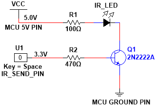

# AC Controller

ESP8266/ESP32 firmware that controls a AC over IR through a
web API.

## Setup

1. Copy `include/secrets.template.hpp` to `include/secrets.hpp` and fill
   in your values.
2. Set `IR_SEND_PIN` in `include/ac/controller.hpp` (default: GPIO4).
3. Build and upload

## Circuit

Adjust R1 to your IR LEDs current limit.